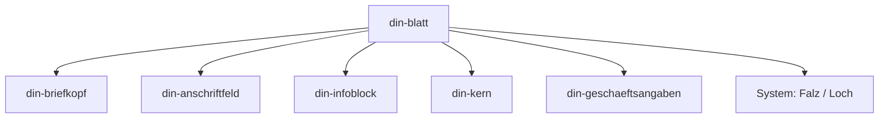

# IMR 4.0 — DIN 5008 Registry

Die IMR-Registry ist das normative Master-Modell des DIN-Briefes. Sie definiert Vokabular, kanonische Tags, Zonen, Beziehungen und belegte normative Geometrie. HTML implementiert dieses Modell, CSS rendert es, JavaScript erzeugt keine konkurrierende normative Geometriequelle.

**Atom-Träger im DOM.** Ist die Eingabe eines Atoms nativ, trägt das Element `data-atom` (z. B. `<input data-atom id="empfaenger-name">`); das Inventar führt dazu `"eingabe": "input"`. `data-feldtyp` bleibt ausschließlich für abweichendes Verhalten (`zweizeilig`, `mehrzeilig`, `rich …`, `liste`, `systemwert`) — der Wert `einzeilig` existiert nicht mehr, weil ein `<input type="text">` per Definition einzeilig ist.

Die registrierten Atome (55; 7+9+9+14+13+3, siehe Inventar) sind das vollständige fachliche Vokabular. Ein konkreter Brief instantiiert nur die benötigte Teilmenge. Nicht-Vorkommen ist kein Fehler. Ein instantiiertes Atom wird als kanonisches `<din-…>`-Element repräsentiert. Das verlangt keine JavaScript-Registrierung und keine Custom-Element-Klasse.

Die Atomliste steht ausschließlich im Inventar („Maschinenlesbares Inventar"). Prosa nennt keine Anzahl, die nicht dort steht. Overlay ist kein Atom.

> [!NOTE]
> Das Anschriftfeld hat eine feste Höhe von 45 mm. Überlaufender Text wird durch den Overflow-Alarm visuell markiert. Das Overflow-Verhalten selbst ist Rendering, nicht zusätzliche Atom-Geometrie.

---

## Registry Contract

Diese Registry ist die **einzige normative Quelle** für: kanonische Tags, Atom-Identität, Zonen- und System-Atom-Identität, erlaubte Beziehungen, belegte Geometrie und die Form-A/Form-B-Y-Werte. HTML, CSS und JavaScript sind **abgeleitete Implementierungen**.

**Regelvokabular:** MUST (zwingend) · MUST-NOT (verboten) · SHOULD (stark empfohlen) · MAY (zulässig).

### MUST-NOT

1. MUST-NOT: ein Atom außerhalb des Inventars (§0) definieren.
2. MUST-NOT: ein `din-*` ohne Registry-Eintrag verwenden (siehe Namespace).
3. MUST-NOT: Synonyme, Kompositionen, Satelliten, Zonen oder Rendering-Bezeichner als Atom zählen.
4. MUST-NOT: eine zweite Form oder den Dokumentrahmen als eigenes Atom-Inventar behandeln.
5. MUST-NOT: normative Geometrie in CSS oder JavaScript duplizieren.
6. MUST-NOT: `data-*`-Werte abweichend von dieser Registry pflegen (sie sind generiert, siehe „Maschinenlesbares Inventar").
7. MUST-NOT: nicht belegte X/Y/W/H-Werte rechnerisch als normativ deklarieren.
8. MUST-NOT: einen Alias oder eine Komposition ohne kanonischen Registry-Bezug verwenden.

---

## Namespace

`din-*` ist ausschließlich der kanonische Namespace dieses Modells. Jeder `din-*`-Bezeichner gehört exakt einer Kategorie an:

| Kategorie | Umfang | Beispiele |
|---|---|---|
| DOCUMENT | 1 | `din-blatt` |
| ZONE | 5 | `din-briefkopf`, `din-anschriftfeld`, `din-infoblock`, `din-kern`, `din-geschaeftsangaben` |
| ATOM | 52 | `din-betreff`, `din-anrede`, `din-text`, `din-fuss-iban`, … (vollständig im Inventar) |
| SYSTEM_ATOM | 3 | `din-falzmarke-1`, `din-falzmarke-2`, `din-lochmarke` |

UI-, Rendering- und Kompositions-Bezeichner tragen **keinen** `din-`-Präfix.

---

## Case Contract

Jede Sprache behält ihren nativen Case; Übergänge zwischen Namensräumen folgen den Plattform-Mappings.

| Bereich | Case |
|---|---|
| HTML `id`, `class`, `data-*`, Elementnamen | kebab-case |
| CSS Klassen-/ID-Selektoren, Custom Properties, `@keyframes`, `@property` | kebab-case |
| JavaScript Variablen, Funktionen, Properties | camelCase |
| JavaScript Klassen | PascalCase |
| JavaScript Konstanten | UPPER_SNAKE_CASE |
| Dokument-Dateinamen | bestehende Konvention (nicht umbenennen) |
| Dokument `id:` (Frontmatter) | kebab-case |

**MUST-NOT:** Mixed-/snake-case in HTML/CSS-Identifiern; camelCase in CSS-Klassen/Custom-Properties.

**DATASET-MAPPING (kein Verstoß):** `data-schrift-modus` → `dataset.schriftModus`.

**EXCEPTION:** technische/Plattform-Identifier, die nicht dem Projekt gehören (`font-family`, `::picker()`, Vendor-Präfixe).

---

## Geometrieklassen

Koordinatensystem: DIN-A4-Blatt, 210 mm × 297 mm, Ursprung oben links, Einheit Millimeter. Form A und Form B sind Y-Varianten desselben Modells.

| Klasse | Bedeutung | In dieser Registry |
|---|---|---|
| 1 Absolute Atom-Geometrie | X / Y / W / H in mm, nur wenn belegt | nur die bereits belegten Werte |
| 2 Zonen-Geometrie | Begrenzung der Zone | nur belegte Zonenmaße |
| 3 Flow- / Reihenmodell | Lage in Zone, Zeile oder Spaltenindex ohne eigene Box | explizite Regel, keine abgeleiteten mm |
| 4 Rendering | CSS, `%`, Custom Properties, Ellipsis, Zeilenhöhe als Technik | nicht normativ |

Fehlt eine belastbare absolute Atom-Box:

`absolute geometry: not independently specified`

Vorhandene Millimeterwerte werden nicht gelöscht und nicht durch Rechnung ergänzt.

---

## Komposition

`din-empfaenger-vorname` und `din-empfaenger-nachname` dürfen in einem Brief als gemeinsame Namenszeile in der Anschriftzone erscheinen. Das erzeugt kein Atom `din-empfaenger-name`. Die Split-Tags werden nur instantiiert, wenn Vor- und Nachname getrennt geführt werden.

Dasselbe gilt für `din-absender-vorname` und `din-absender-nachname` in der Zone, in der der Absenderkontakt tatsächlich liegt.

Ein optionales Unterschriftsbild ist Satellit von `din-unterschrift`, kein eigenes Atom.

---

## Synonym- und Alias-Registry

Erlaubte und verbotene Nicht-Atom-Bezeichner. **Kein Eintrag dieser Tabelle ist ein Atom.**

| Nicht-kanonischer Name | Typ | Kanonischer Bezug | Status |
|---|---|---|---|
| `empfaenger-name` | Komposition | `din-empfaenger-vorname` + `din-empfaenger-nachname` | erlaubt |
| `absender-name` | Komposition | `din-absender-vorname` + `din-absender-nachname` | erlaubt |
| `unterschriftsbild-*` | Satellit | `din-unterschrift` | erlaubt |
| `brief-ansicht`, `brief-kommentar` | Rendering | — (kein Atom) | erlaubt |
| `din-empfaenger-name` | Atom (DIN 20.7.4, interpretiert) | Empfängerbezeichnungen | erlaubt |
| `din-absender-name` | Atom (DIN 19.4.2) | Name oder Bezeichnung des Absenders | erlaubt |

Diese Liste ist maschinenlesbar im JSON-Inventar unter `vocabulary` hinterlegt; `tools/imr.js` prüft sie gegen den Code.

**Kanonisches Vokabular:** Blatt · Anschrift · Anschriftfeld · Infoblock · Briefkern · Text · Betreff · Absender · Datum · Unterschrift · Fuss · Schrift · Hinweis · Seitenleiste · Aktion · Ansicht.

**Technische Ausnahmen (nicht automatisch geprüft):** `font-family`/`font-size`/… (native CSS), `FontFace` (native API), `fontsource` (Brand), `touch-action`/`action` (native CSS bzw. JS-Schlüssel), `Adresse` (Input-Parsing: Postadresse/Anschrift-Labels), Dateinamen `sidebar.css`/`32-toast.js`.

---

## Autorität und Herkunft

Jeder normative Wert trägt seine Herkunft:

| Herkunft | Bedeutung |
|---|---|
| DIN | aus DIN 5008 abgeleitet — **gegen DIN 5008:2020-03 + Berichtigung 1:2020-07 zu verifizieren** |
| PROJECT | projektspezifische Modell-/Layoutentscheidung |
| IMPLEMENTATION | technische Umsetzung (Rendering), nicht normativ |

Als `PROJECT` geführt: die 8-mm-Begrenzung der Falz-/Lochmarken, die Kollisionsvermeidung mit dem Betreff, die feste 45-mm-Höhe des Anschriftfelds und der Form-A/B-Schalter. Die Millimeterwerte (210/297, 25/125, 27/45/34/51/74/92/91/109/87/105/192/210, 148,5) sind als `DIN` geführt und **noch zu verifizieren**.

---

## Platzierung Kontakt

Die sieben Absender-Atome haben die Default-Zone `din-briefkopf` (Briefkopf).

Sie MAY in `din-infoblock` liegen, wenn der konkrete Brief den Kontakt rechts führt.

Dieselbe Angabe darf nicht parallel in Briefkopf und Infoblock instantiiert werden.

---

## Ebenen

```
din-blatt                      Dokumentrahmen 210 × 297, kein Atom
├── din-briefkopf              ZONE Briefkopf (optional)
├── din-anschriftfeld          ZONE Fenster
├── din-infoblock              ZONE rechts
│   └── din-datum              Atom (letzte Zeile des Blocks, keine eigene Y)
├── din-kern                   ZONE Briefkörper
├── din-geschaeftsangaben      ZONE Fuß
├── din-falzmarke-1            SYSTEM-Atom
├── din-falzmarke-2            SYSTEM-Atom
└── din-lochmarke              SYSTEM-Atom
```

Zonen sind keine Atome.



---

## Übersicht der Atomgruppen

| Bereich | Anzahl | Zone / Gruppe |
|---|---|---|
| Absender | 7 | `<din-briefkopf>` Default; MAY Infoblock |
| Anschrift | 9 | `<din-anschriftfeld>` |
| Infoblock | 9 | `<din-infoblock>`; Datum als letzte Zeile, ohne eigene Y |
| Kern | 14 | `<din-kern>` |
| Fuß | 13 | `<din-geschaeftsangaben>` |
| System | 3 | Blatt, keine Inhaltszone |
| **Summe** | **55** | (Inventar ist die Quelle) |

---

## 0. Dokumentrahmen

**Element:** `<din-blatt>`  
**Rolle:** Dokumentwurzel, kein Atom.  
**Normative Fläche:** Breite 210 mm, Höhe 297 mm.

### Form A und Form B

Dasselbe Blatt, dieselben Zonen und Atome. Form A und Form B unterscheiden sich nur durch belegte **Y-Lagen**. Es ist keine zweite Dokumentart und kein drittes Layout.

Belegte Y-Paare (bereits in den Zonen- und Systemabschnitten):

| Objekt | Y Form A | Y Form B | Herkunft |
|---|---|---|---|
| Zone `din-briefkopf` | 27 mm | 45 mm | DIN 19.4.2 nennt die **Feldhöhe** 27/45 mm; sie als Y-Position zu verwenden ist PROJECT |
| Zone `din-anschriftfeld` | 28,9 mm | 45,8 mm | DIN 19.4.3 — Feldoberkante, 5,0 mm über der ersten Schreibzeile (33,9/50,8); Anschriftzone beginnt bei 46,6/63,5 mm |
| Zone `din-infoblock` | 34 mm | 51 mm | DIN |
| Zone `din-kern` | 91 mm | 109 mm | DIN |
| Atom `din-falzmarke-1` | 87 mm | 105 mm | DIN 19.8 |
| Atom `din-falzmarke-2` | 192 mm | 210 mm | DIN 19.8 |

Unverändert zwischen den Formen, soweit belegt: Blatt 210 × 297, Anschrift W 85 H 45, Infoblock X 125, Kern X 25 W 165, Fuß X 25 Y 241 W 165, Lochung Y 148,5 mm.

**Band pro Blatt.** Nutzbar sind 25–277 mm (Oberrand 25 mm ab Seite 2, Unterrand 20 mm aus `@page`). Seite 1 trägt zusätzlich 0–25 mm für Briefkopf und Anschrift (DIN 19.4.2); ihr Textfluss beginnt wie auf jeder Folgeseite erst im Band. Diese Banddefinition ist der Soll-Anker für den Geometrie-Check gegen `pdftotext -bbox`.

Wie HTML den Form-Schalter speichert und wie CSS die Y-Werte umsetzt, ist Rendering, nicht Teil dieses Modells.

---

## 1. Zone Absender (Briefkopf)

**Zone:** `<din-briefkopf>`  
**Rolle:** optionaler Briefkopf. Keine Pflicht, alle acht Atome zu instantiieren.  
**Zonen-Geometrie:** X 25 mm. Y Form A 27 mm, Form B 45 mm. Breite und Höhe der Zone: `absolute geometry: not independently specified`.

| Atom | Tag | DIN 5008 | Rolle | DOM / ID | Anmerkung |
|---|---|---|---|---|---|
| `absender-name` | `<din-absender-name>` | 19.4.2 *(interpretiert)* | atom | ja, `#absender-name` | Name oder Bezeichnung des Absenders; Alternative zur Split-Komposition |
| `absender-vorname` | `<din-absender-vorname>` | 19.4.2 *(interpretiert)* | atom | nein | nur wenn Vor-/Nachname getrennt geführt werden |
| `absender-nachname` | `<din-absender-nachname>` | 19.4.2 *(interpretiert)* | atom | nein | nur wenn Vor-/Nachname getrennt geführt werden |
| `absender-strasse` | `<din-absender-strasse>` | 19.4.2 | atom | ja, `#absender-strasse` | Zustell- oder Abholangabe |
| `absender-ort` | `<din-absender-ort>` | 19.4.2 | atom | ja, `#absender-ort` | PLZ und Ort (Gliederung: 11.3.3) |
| `absender-mail` | `<din-absender-mail>` | 19.4.2 | atom | ja, `#absender-mail` | Kommunikationsangabe, MAY Infoblock (20.8) |
| `absender-tel` | `<din-absender-tel>` | 19.4.2 | atom | ja, `#absender-tel` | Kommunikationsangabe, Gliederung 11.3.2 |

Fachliche Bezüge: DIN 5008 Absenderangaben. Keine CSS-Custom-Property ist Teil dieser Normwerte.

---

## 2. Zone Anschriftfeld

**Zone:** `<din-anschriftfeld>`  
**ARIA:** `group`  
**Zonen-Geometrie:** X 25 mm, Breite 85 mm (Feld), Textlauf 25–105 mm = 80 mm (Tab. A.1). Blockoberkante Form A 28,9 mm, Form B 45,8 mm (Feldkante; DIN 33,9/50,8 sind die ersten Schreibzeilen); darunter die Anschriftzone mit Y Form A 46,7 mm, Form B 63,7 mm (DIN 46,6/63,5). Höhe 45 mm (fix) für beide Zonen zusammen.

**Zusatz-/Vermerkzone.** 17,7 × 85 mm, davon 5,0 mm Rand über der ersten Schreibzeile; Schreibraster 3 Zeilen à 4,23 mm (Tab. B.1: 50,8 / 59,2 / 63,5 mm, Zeilen 13–15). Der Block beschriftet sich von unten nach oben (DIN 20.7.1): Rücksendeangabe ist die oberste *belegte* Zeile, Vermerke stehen darunter, der Block schiebt sich zeilenweise nach oben. Belegt werden 1–2 Zeilen (binär: ohne/mit Postvermerk).

Die Höhe 45 mm ist Zonenmaß, keine Atom-Box. Die Rücksendeangabe ist das erste Kind der Zone und besetzt die oberste belegte Zeile des von unten beschrifteten Blocks (DIN 19.4.3/20.7.1: Rücksendeangabe oben, Vermerke darunter).

| Atom | Tag | DIN 5008 | Rolle | DOM / ID | Anmerkung |
|---|---|---|---|---|---|
| `rucksendeangabe` | `<din-rucksendeangabe>` | 19.4.3 | atom | ja, `#rucksendeangabe` | einzeilig, 7 pt (Nutzerentscheidung, DIN-Ausnahmebereich 6–8 pt), oberste belegte Zeile des Blocks |
| `vermerke` | `<input id="vermerke">` | 19.4.3 | atom | ja, `#vermerke` | Zusatz- und Vermerkzone |
| `empfaenger-firma` | `<din-empfaenger-firma>` | 20.7.2 | atom | ja, `#empfaenger-firma` | Empfängerbezeichnung |
| `empfaenger-abteilung` | `<din-empfaenger-abteilung>` | 20.7.4 *(interpretiert)* | atom | nein | DIN 19.5 nennt „Abteilung" als Leitwort des Infoblocks |
| `empfaenger-name` | `<din-empfaenger-name>` | 20.7.4 *(interpretiert)* | atom | ja, `#empfaenger-name` | DIN spricht von „Empfängerbezeichnungen" (mehrzeilig) |
| `empfaenger-vorname` | `<din-empfaenger-vorname>` | 20.7.4 *(interpretiert)* | atom | nein | Kompositions-Option |
| `empfaenger-nachname` | `<din-empfaenger-nachname>` | 20.7.4 *(interpretiert)* | atom | nein | Kompositions-Option |
| `empfaenger-strasse` | `<din-empfaenger-strasse>` | 20.7.2 | atom | ja, `#empfaenger-strasse` | Inlandsanschrift |
| `empfaenger-ort` | `<din-empfaenger-ort>` | 20.7.2 | atom | ja, `#empfaenger-ort` | PLZ und Ort (Gliederung: 11.3.3) |

Schriftgröße der Rücksendezeile ist ein typografischer Parameter, keine Millimeter-Box. Aktuell 7 pt (`data-font="7"`) — DIN 19.4.3 nennt 8 pt als Standard und 6 pt als Minimum; 7 pt liegt im Ausnahmebereich und ist eine bewusste Nutzerentscheidung (2026-11-11).

---

## 2a. Anschriftfeld — Ist vs. DIN Tab. B.1 (gemessen 2026-11-11, `9716cff` + `6fd0d2f`)

Gemessen im PDF (`pdftotext -bbox`, erster Buchstabe der jeweiligen Zeile), nicht im DOM.

| Element | Form A Ist | Form A DIN | Δ | Form B Ist | Form B DIN | Δ |
|---|---:|---:|---:|---:|---:|---:|
| Rücksendeangabe | 42,37 mm¹ | 42,3 mm | +0,07 | 59,27 mm | 59,2 mm | +0,07 |
| Empfängeranschrift | 46,60 mm¹ | 46,6 mm | ±0,00 | 63,50 mm | 63,5 mm | ±0,00 |
| Informationsblock | 34,37 mm | 33,9 mm | +0,47 | 51,30 mm | 50,8 mm | +0,50 |

¹ Form A nicht neu gemessen: Feldkante 28,9 mm + 17,7 mm Zusatzzone = 46,6 mm (Empfänger), Rücksendezeile eine Rasterzeile darüber = 42,3 mm. Form B ist gemessen.

**Zuordnung.** Die `data-*`-Attribute sind DIN-konform und werden so gelesen,
wie sie benannt sind:

| Attribut | Wert A/B | DIN Tab. B.1 | Δ | Wird im CSS verwendet als |
|---|---:|---:|---:|---|
| `data-anschriftfeld-y` | 28,9 / 45,8 | Feldoberkante (5,0 mm über Zeile 13) | ±0,0 | Oberkante des Feldes; die Zonen tragen 17,7 + 27,3 mm |
| `+ 12,7 mm` = 3 Schreibzeilen (Tab. B.1: 50,8 / 59,2 / 63,5) | 46,7 / 63,7 | Empfängeranschrift 46,6 / 63,5 | +0,1 / +0,2 | `padding-top` der Zone (`sheet-multipage.css:190`) |
| `data-briefkopf-y` | 27 / 45 | (19.4.2 nennt nur die Feldhöhe) | — | nur im stillgelegten `sheet.css` |

Die Anschriftzone liegt 12,7 mm unter der Blockoberkante — genau drei
Schreibzeilen, die Tab. B.1 zwischen Zeile 13 und Zeile 16 ansetzt. Die
Rücksendezeile sitzt nicht auf der Oberkante, sondern auf der untersten
belegten Zeile (59,2/42,3 mm, DIN 20.7.1).

**Status:** umgesetzt in `9716cff` (Blockoberkante) und `6fd0d2f`
(Empfänger-Raster 4,23 mm), gemessen 2026-11-11. Die früher erwogenen Varianten
(Zone weglassen, Weißraum gestalten) sind damit erledigt; die Abwägung steht im
[[DECISION-LOG]].

---

## 3. Zone Infoblock (Metadaten)

**Zone:** `<din-infoblock>`  
**ARIA:** `group`  
**Zonen-Geometrie:** X 125 mm. Y Form A 34 mm, Form B 51 mm. Breite und Höhe der Zone: `absolute geometry: not independently specified`.

Kontakt-Atome der Absendergruppe MAY hier instantiiert werden (siehe Platzierung).

| Atom | Tag | DIN 5008 | Rolle | DOM / ID | Anmerkung |
|---|---|---|---|---|---|
| `datum` | `<din-datum>` | 20.8 | atom | ja, `#datum` | letzte Zeile des Infoblocks (19.5), keine eigene Y; Schreibung 11.4 |
| `ihr-zeichen` | `<din-ihr-zeichen>` | 20.8 | atom | nein | Leitwort |
| `ihr-schreiben` | `<din-ihr-schreiben>` | 20.8 | atom | nein | Leitwort „Ihre Nachricht vom" |
| `unser-zeichen` | `<din-unser-zeichen>` | 20.8 | atom | nein | Leitwort |
| `unser-schreiben` | `<din-unser-schreiben>` | 20.8 | atom | nein | Leitwort „Unsere Nachricht vom" |
| `durchwahl` | `<din-durchwahl>` | 20.8 *(interpretiert)* | atom | nein | DIN-Leitwort ist „Telefon" |
| `email-direkt` | `<din-email-direkt>` | 20.8 | atom | nein | Leitwort „E-Mail" |
| `internet` | `<din-internet>` | 20.8 | atom | nein | Internetadresse |
| `bezugszeichen` | `<din-bezugszeichen>` | 20.8 | atom | ja, `#bezugszeichen` | Sammelatom der Leitwörter |

---

## 4. Zone Briefkern

**Zone:** `<din-kern>`  
**Zonen-Geometrie:** X 25 mm. Y Form A 91 mm, Form B 109 mm. Breite 165 mm. Höhe der Zone: `absolute geometry: not independently specified`.

Der Betreff beginnt fachlich unter der ersten Falzmarke. Die Falz-Y-Werte stehen nur bei den System-Atomen.
Normative Kollisionsvermeidung (ehemals ADR-BETREFF): Falzmarken dürfen nicht in die Zone `din-kern` hineinragen oder den Betreff optisch durchschneiden. Sie werden am linken Blattrand auf eine funktionale Markierungslänge von 8 mm beschränkt.

| Atom | Tag | DIN 5008 | Rolle | DOM / ID | Anmerkung |
|---|---|---|---|---|---|
| `betreff` | `<input id="betreff">` | 20.9 | atom | ja, `#betreff` | höchstens zwei Zeilen (Empfehlung) |
| `anrede` | `<input id="anrede">` | 20.9.4 | atom | ja, `#anrede` |  |
| `text` | `<din-text>` | 20.10 | atom | ja, `#text` | mehrzeilig |
| `grussformel` | `<input id="grussformel">` | 20.11 | atom | ja, `#grussformel` | DIN: „Gruß" |
| `unternehmensbezeichnung` | `<din-unternehmensbezeichnung>` | 20.12 | atom | ja, `#unternehmensbezeichnung` |  |
| `unterschrift` | `<input id="unterschrift">` | 20.13 | atom | ja, `#unterschrift` | DIN: „Angabe der Unterzeichnenden" |
| `zusaetze` | `<din-zusaetze>` | 20.14 | atom | ja, `#zusaetze` |  |
| `anlagenvermerk` | `<din-anlagenvermerk>` | 20.15.2 | container | ja, `#anlagenvermerk` | Container; Kinder: `label.anlagen-heading`, `din-anlagen-angabe` (Wrapper) |
| `anlagen-angabe` | `<din-anlagen-angabe>` | 20.15.2 | container | nein | Wrapper um `<textarea id="anlagen-angabe">`; kein contenteditable ([[ADR-ANLAGEN-TEXTAREA]]) |
| `verteilvermerk` | `<din-verteilvermerk>` | 20.15.3 | atom | ja, `#verteilvermerk` |  |
| `beglaubigungsvermerk` | `<din-beglaubigungsvermerk>` | 20.16 | atom | ja, `#beglaubigungsvermerk` |  |
| `werbliche-elemente` | `<din-werbliche-elemente>` | 20.18 | atom | ja, `#werbliche-elemente` |  |

Blocksatz und Silbentrennung sind Rendering.

---

## 5. Zone Fuß

**Zone:** `<din-geschaeftsangaben>`  
**ARIA:** `contentinfo`  
**Zonen-Geometrie:** X 25 mm. Y 241 mm. Breite 165 mm. Höhe der Zone: `absolute geometry: not independently specified`.

Layout in vier Spalten ist Rendering. Normativ belegt sind die Y-Reihen und der Spaltenindex, nicht die Millimeter-X/W der einzelnen Atome. Die konkrete Zuordnung Atom → Spalte steht als `grid-area` in `website/css/sheet-common.css:87–109` — sie ist Rendering und deshalb bewusst kein Inventarfeld. `website/css/sheet.css` wird von `website/index.html:31–34` nicht geladen; seine Regeln sind stillgelegt.

| Atom | Tag | DIN 5008 | Rolle | DOM / ID | Anmerkung |
|---|---|---|---|---|---|
| `fuss-firma` | `<input id="fuss-firma">` | 19.7 | atom | ja, `#fuss-firma` | Firmenname laut Handelsregister |
| `fuss-sitz` | `<input id="fuss-sitz">` | 19.7 | atom | ja, `#fuss-sitz` | Rechtsform und Sitz |
| `fuss-gericht` | `<input id="fuss-gericht">` | 19.7 | atom | ja, `#fuss-gericht` | Registergericht |
| `fuss-hrb` | `<input id="fuss-hrb">` | 19.7 | atom | ja, `#fuss-hrb` | Handelsregisternummer |
| `fuss-vorstand` | `<input id="fuss-vorstand">` | 19.7 | atom | ja, `#fuss-vorstand` | Vorsitz und Mitglieder des Vorstands |
| `fuss-gf` | `<input id="fuss-gf">` | 19.7 | atom | ja, `#fuss-gf` | Geschäftsführer |
| `fuss-stnr` | `<input id="fuss-stnr">` | 19.6 | atom | ja, `#fuss-stnr` | Steuernummer |
| `fuss-ustid` | `<input id="fuss-ustid">` | 19.6 | atom | ja, `#fuss-ustid` | USt-IdNr. |
| `fuss-bank` | `<input id="fuss-bank">` | 19.6 | atom | ja, `#fuss-bank` | Kontoverbindung |
| `fuss-iban` | `<input id="fuss-iban">` | 19.6 | atom | ja, `#fuss-iban` | Gliederung 11.3.1 |
| `fuss-bic` | `<input id="fuss-bic">` | 19.6 | atom | ja, `#fuss-bic` |  |
| `fuss-anschrift` | `<input id="fuss-anschrift">` | 19.6 | atom | ja, `#fuss-anschrift` | Geschäftsräume |
| `seitennummerierung` | `<din-seitennummerierung>` | 20.17 | atom | ja, `#seitennummerierung` |  |

Spalte 2 hat in diesem Modell keine belegte Zeile bei Y 246. Das bleibt eine Lücke, kein neuer Wert.

---

## 6. System

Genau drei Atome. Sie liegen auf dem Blatt, nicht in einer Inhaltszone.

| Atom | Tag | DIN 5008 | DOM | Belegte Geometrie |
|---|---|---|---|---|
| `din-falzmarke-1` | `<din-falzmarke-1>` | 19.8 | ja | Y Form A 87 mm, Form B 105 mm, X 0 mm, W 8 mm |
| `din-falzmarke-2` | `<din-falzmarke-2>` | 19.8 | ja | Y Form A 192 mm, Form B 210 mm, X 0 mm, W 8 mm |
| `din-lochmarke` | `<din-lochmarke>` | 19.8 | ja | Y 148,5 mm, X 0 mm, W 8 mm |

Die Breite von exakt 8 mm am linken Papierrand verhindert jede optische Kollision mit dem Betreff- oder Textbereich (ehemals ADR-BETREFF).

### Overlay (kein Atom)

Eine optionale visuelle Hilfsebene für Layout-Kontrolle. Sie gehört zu keinem Atom und hat keine normative Atom-Geometrie in diesem Modell.

---

## Nicht-atomare Bezeichner

Der Präfix `din-` ist reserviert für Atome, Zonen und den Dokumentrahmen (`din-blatt`). Alles andere trägt keinen `din-`-Präfix.

### Y-Geometrie (Datenschicht am `<din-blatt>`)

Die Y-Koordinaten kommen ausschließlich aus `data-<atom|zone>-y-a` (Form A) und `data-<atom|zone>-y-b` (Form B). Beispiele: `data-kern-y-a`, `data-falz-oben-y-a`, `data-lochmarke-y`. CSS liest sie per `attr()` **ohne** Fallback-Argument (`sheet-common.css:29–46`): fehlt ein Attribut, ist die Deklaration ungültig und die Position fällt auf `auto` zurück.

### Rendering- und Kompositions-Bezeichner

| Bezeichner | Rolle |
|---|---|
| `brief-ansicht` | Viewport-/Scroll-Wrapper des Blattes |
| `brief-kommentar` | Inline-Kommentar-Markierung im Text (kein Atom) |
| `--blatt-breite`, `--blatt-hoehe` | Blattmaße aus `data-width-mm`/`data-height-mm` |
| `unterschriftsbild-*` | Satellit von `din-unterschrift` (Bild, Rahmen, Griffe) |
| `din-info-*` | UI-Modal für DIN 5008 Leitfaden (Dialog, Titel, Content) |

### Namenszeile (Komposition, kein Atom)

`din-empfaenger-vorname`/`-nachname` und `din-absender-vorname`/`-nachname` dürfen als **eine** Zeile erscheinen (siehe Komposition). Die kombinierte Eingabezeile heißt im Code `empfaenger-name` bzw. `absender-name`. Das gleichnamige Atom (`din-empfaenger-name`, `din-absender-name`) ist die registrierte Ein-Zeilen-Form; die Split-Atome instantiieren nur, wer Vor- und Nachname getrennt führt.

---

## Maschinenlesbares Inventar

Normative maschinenlesbare Fassung für Geometrie, verbotene Aliase und Kompositionen. Dieser Block ist die normative Quelle für Atome, Zonen, `dinSection`, Geometrie und Beziehungen; die Tabellen oben sind seine lesbare Fassung. `tools/imr.js` validiert das Inventar und leitet daraus die `data-*`-Werte des `<din-blatt>` ab.

<!-- IMR-INVENTORY:START -->
```json
{
  "sheet": {
    "width": 210,
    "height": 297
  },
  "document": "din-blatt",
  "zones": [
    "din-briefkopf",
    "din-anschriftfeld",
    "din-infoblock",
    "din-kern",
    "din-geschaeftsangaben"
  ],
  "systemAtoms": [
    "din-falzmarke-1",
    "din-falzmarke-2",
    "din-lochmarke"
  ],
  "deprecatedTags": {},
  "atoms": {
    "din-absender-name": {
      "id": "absender-name",
      "role": "atom",
      "dinSection": "19.4.2",
      "source": "DIN (interpretiert)",
      "inDom": true,
      "export": true,
      "eingabe": "input"
    },
    "din-absender-vorname": {
      "id": null,
      "role": "atom",
      "dinSection": "19.4.2",
      "source": "DIN (interpretiert)",
      "inDom": false,
      "export": false
    },
    "din-absender-nachname": {
      "id": null,
      "role": "atom",
      "dinSection": "19.4.2",
      "source": "DIN (interpretiert)",
      "inDom": false,
      "export": false
    },
    "din-absender-strasse": {
      "id": "absender-strasse",
      "role": "atom",
      "dinSection": "19.4.2",
      "source": "DIN",
      "inDom": true,
      "export": true,
      "eingabe": "input"
    },
    "din-absender-ort": {
      "id": "absender-ort",
      "role": "atom",
      "dinSection": "19.4.2",
      "source": "DIN",
      "inDom": true,
      "export": true,
      "eingabe": "input"
    },
    "din-absender-mail": {
      "id": "absender-mail",
      "role": "atom",
      "dinSection": "19.4.2",
      "source": "DIN",
      "inDom": true,
      "export": true,
      "eingabe": "input"
    },
    "din-absender-tel": {
      "id": "absender-tel",
      "role": "atom",
      "dinSection": "19.4.2",
      "source": "DIN",
      "inDom": true,
      "export": true,
      "eingabe": "input"
    },
    "din-rucksendeangabe": {
      "id": "rucksendeangabe",
      "role": "atom",
      "dinSection": "19.4.3",
      "source": "DIN",
      "inDom": true,
      "export": true,
      "eingabe": "input"
    },
    "din-vermerke": {
      "id": "vermerke",
      "role": "atom",
      "dinSection": "19.4.3",
      "source": "DIN",
      "inDom": true,
      "export": true,
      "eingabe": "input"
    },
    "din-empfaenger-firma": {
      "id": "empfaenger-firma",
      "role": "atom",
      "dinSection": "20.7.2",
      "source": "DIN",
      "inDom": true,
      "export": true,
      "eingabe": "input"
    },
    "din-empfaenger-abteilung": {
      "id": null,
      "role": "atom",
      "dinSection": "20.7.4",
      "source": "DIN (interpretiert)",
      "inDom": false,
      "export": false
    },
    "din-empfaenger-name": {
      "id": "empfaenger-name",
      "role": "atom",
      "dinSection": "20.7.4",
      "source": "DIN (interpretiert)",
      "inDom": true,
      "export": true,
      "eingabe": "input"
    },
    "din-empfaenger-vorname": {
      "id": null,
      "role": "atom",
      "dinSection": "20.7.4",
      "source": "DIN (interpretiert)",
      "inDom": false,
      "export": false
    },
    "din-empfaenger-nachname": {
      "id": null,
      "role": "atom",
      "dinSection": "20.7.4",
      "source": "DIN (interpretiert)",
      "inDom": false,
      "export": false
    },
    "din-empfaenger-strasse": {
      "id": "empfaenger-strasse",
      "role": "atom",
      "dinSection": "20.7.2",
      "source": "DIN",
      "inDom": true,
      "export": true,
      "eingabe": "input"
    },
    "din-empfaenger-ort": {
      "id": "empfaenger-ort",
      "role": "atom",
      "dinSection": "20.7.2",
      "source": "DIN",
      "inDom": true,
      "export": true,
      "eingabe": "input"
    },
    "din-datum": {
      "id": "datum",
      "role": "atom",
      "dinSection": "20.8",
      "source": "DIN",
      "inDom": true,
      "export": true,
      "eingabe": "input"
    },
    "din-ihr-zeichen": {
      "id": null,
      "role": "atom",
      "dinSection": "20.8",
      "source": "DIN",
      "inDom": false,
      "export": false
    },
    "din-ihr-schreiben": {
      "id": null,
      "role": "atom",
      "dinSection": "20.8",
      "source": "DIN",
      "inDom": false,
      "export": false
    },
    "din-unser-zeichen": {
      "id": null,
      "role": "atom",
      "dinSection": "20.8",
      "source": "DIN",
      "inDom": false,
      "export": false
    },
    "din-unser-schreiben": {
      "id": null,
      "role": "atom",
      "dinSection": "20.8",
      "source": "DIN",
      "inDom": false,
      "export": false
    },
    "din-durchwahl": {
      "id": null,
      "role": "atom",
      "dinSection": "20.8",
      "source": "DIN (interpretiert)",
      "inDom": false,
      "export": false
    },
    "din-email-direkt": {
      "id": null,
      "role": "atom",
      "dinSection": "20.8",
      "source": "DIN",
      "inDom": false,
      "export": false
    },
    "din-internet": {
      "id": null,
      "role": "atom",
      "dinSection": "20.8",
      "source": "DIN",
      "inDom": false,
      "export": false
    },
    "din-bezugszeichen": {
      "id": "bezugszeichen",
      "role": "atom",
      "dinSection": "20.8",
      "source": "DIN",
      "inDom": true,
      "export": false
    },
    "din-betreff": {
      "id": "betreff",
      "role": "atom",
      "dinSection": "20.9",
      "source": "DIN",
      "inDom": true,
      "export": true,
      "eingabe": "input"
    },
    "din-anrede": {
      "id": "anrede",
      "role": "atom",
      "dinSection": "20.9.4",
      "source": "DIN",
      "inDom": true,
      "export": true,
      "eingabe": "input"
    },
    "din-text": {
      "id": "text",
      "role": "atom",
      "dinSection": "20.10",
      "source": "DIN",
      "inDom": true,
      "export": true
    },
    "din-grussformel": {
      "id": "grussformel",
      "role": "atom",
      "dinSection": "20.11",
      "source": "DIN",
      "inDom": true,
      "export": true,
      "eingabe": "input"
    },
    "din-unternehmensbezeichnung": {
      "id": "unternehmensbezeichnung",
      "role": "atom",
      "dinSection": "20.12",
      "source": "DIN",
      "inDom": true,
      "export": false
    },
    "din-unterschrift": {
      "id": "unterschrift",
      "role": "atom",
      "dinSection": "20.13",
      "source": "DIN",
      "inDom": true,
      "export": true,
      "eingabe": "input"
    },
    "din-zusaetze": {
      "id": "zusaetze",
      "role": "atom",
      "dinSection": "20.14",
      "source": "DIN",
      "inDom": true,
      "export": false
    },
    "din-anlagenvermerk": {
      "id": "anlagenvermerk",
      "role": "container",
      "dinSection": "20.15.2",
      "source": "DIN",
      "inDom": true,
      "export": false
    },
    "din-anlagen-angabe": {
      "id": null,
      "role": "container",
      "dinSection": "20.15.2",
      "source": "DIN",
      "inDom": true,
      "export": false,
      "note": "Wrapper um <textarea id=\"anlagen-angabe\">; kein contenteditable (ADR-ANLAGEN-TEXTAREA)"
    },
    "din-verteilvermerk": {
      "id": "verteilvermerk",
      "role": "atom",
      "dinSection": "20.15.3",
      "source": "DIN",
      "inDom": true,
      "export": false
    },
    "din-beglaubigungsvermerk": {
      "id": "beglaubigungsvermerk",
      "role": "atom",
      "dinSection": "20.16",
      "source": "DIN",
      "inDom": true,
      "export": false
    },
    "din-werbliche-elemente": {
      "id": "werbliche-elemente",
      "role": "atom",
      "dinSection": "20.18",
      "source": "DIN",
      "inDom": true,
      "export": false
    },
    "din-fuss-firma": {
      "id": "fuss-firma",
      "role": "atom",
      "dinSection": "19.7",
      "source": "DIN",
      "inDom": true,
      "eingabe": "input",
      "export": false
    },
    "din-fuss-sitz": {
      "id": "fuss-sitz",
      "role": "atom",
      "dinSection": "19.7",
      "source": "DIN",
      "inDom": true,
      "eingabe": "input",
      "export": false
    },
    "din-fuss-gericht": {
      "id": "fuss-gericht",
      "role": "atom",
      "dinSection": "19.7",
      "source": "DIN",
      "inDom": true,
      "eingabe": "input",
      "export": false
    },
    "din-fuss-hrb": {
      "id": "fuss-hrb",
      "role": "atom",
      "dinSection": "19.7",
      "source": "DIN",
      "inDom": true,
      "eingabe": "input",
      "export": false
    },
    "din-fuss-vorstand": {
      "id": "fuss-vorstand",
      "role": "atom",
      "dinSection": "19.7",
      "source": "DIN",
      "inDom": true,
      "eingabe": "input",
      "export": false
    },
    "din-fuss-gf": {
      "id": "fuss-gf",
      "role": "atom",
      "dinSection": "19.7",
      "source": "DIN",
      "inDom": true,
      "eingabe": "input",
      "export": false
    },
    "din-fuss-stnr": {
      "id": "fuss-stnr",
      "role": "atom",
      "dinSection": "19.6",
      "source": "DIN",
      "inDom": true,
      "eingabe": "input",
      "export": false
    },
    "din-fuss-ustid": {
      "id": "fuss-ustid",
      "role": "atom",
      "dinSection": "19.6",
      "source": "DIN",
      "inDom": true,
      "eingabe": "input",
      "export": false
    },
    "din-fuss-bank": {
      "id": "fuss-bank",
      "role": "atom",
      "dinSection": "19.6",
      "source": "DIN",
      "inDom": true,
      "eingabe": "input",
      "export": false
    },
    "din-fuss-iban": {
      "id": "fuss-iban",
      "role": "atom",
      "dinSection": "19.6",
      "source": "DIN",
      "inDom": true,
      "eingabe": "input",
      "export": false
    },
    "din-fuss-bic": {
      "id": "fuss-bic",
      "role": "atom",
      "dinSection": "19.6",
      "source": "DIN",
      "inDom": true,
      "eingabe": "input",
      "export": false
    },
    "din-fuss-anschrift": {
      "id": "fuss-anschrift",
      "role": "atom",
      "dinSection": "19.6",
      "source": "DIN",
      "inDom": true,
      "eingabe": "input",
      "export": false
    },
    "din-seitennummerierung": {
      "id": "seitennummerierung",
      "role": "atom",
      "dinSection": "20.17",
      "source": "DIN",
      "inDom": true,
      "export": false
    },
    "din-falzmarke-1": {
      "id": null,
      "role": "system",
      "dinSection": "19.8",
      "source": "DIN",
      "inDom": true,
      "export": false
    },
    "din-falzmarke-2": {
      "id": null,
      "role": "system",
      "dinSection": "19.8",
      "source": "DIN",
      "inDom": true,
      "export": false
    },
    "din-lochmarke": {
      "id": null,
      "role": "system",
      "dinSection": "19.8",
      "source": "DIN",
      "inDom": true,
      "export": false
    }
  },
  "geometry": {
    "din-briefkopf": {
      "y": {
        "A": 27,
        "B": 45
      },
      "source": "DIN 19.4.2 nennt die Feldhoehe (27/45 mm); als Y-Position verwendet ist PROJECT"
    },
    "din-anschriftfeld": {
      "y": {
        "A": 28.9,
        "B": 45.8
      },
      "note": "Feldoberkante: 5,0 mm ueber der ersten Schreibzeile (DIN 19.4.3). Zusatz-/Vermerkzone 17,7 mm, Anschriftzone 27,3 mm, Summe 45 mm."
    },
    "din-infoblock": {
      "y": {
        "A": 34,
        "B": 51
      }
    },
    "din-kern": {
      "y": {
        "A": 91,
        "B": 109
      }
    },
    "din-falzmarke-1": {
      "y": {
        "A": 87,
        "B": 105
      }
    },
    "din-falzmarke-2": {
      "y": {
        "A": 192,
        "B": 210
      }
    },
    "din-lochmarke": {
      "y": {
        "Y": 148.5
      }
    }
  },
  "forbiddenAliases": [],
  "allowedUiIdentifiers": [
    "din-info",
    "din-info-dialog",
    "din-info-title",
    "din-info-content"
  ],
  "compositions": {
    "empfaenger-name": [
      "din-empfaenger-vorname",
      "din-empfaenger-nachname"
    ],
    "absender-name": [
      "din-absender-vorname",
      "din-absender-nachname"
    ]
  },
  "vocabulary": {
    "canonical": {
      "dokument": [
        "Blatt"
      ],
      "layout": [
        "Zone",
        "Atom",
        "Falz",
        "Lochmarke",
        "Anschriftfeld",
        "Infoblock",
        "Briefkern",
        "Fuss"
      ],
      "inhalt": [
        "Text",
        "Betreff",
        "Anschrift",
        "Absender",
        "Datum",
        "Unterschrift"
      ],
      "ui": [
        "Seitenleiste",
        "Hinweis",
        "Aktion",
        "Schrift",
        "Ansicht"
      ]
    },
    "forbidden": [
      {
        "term": "paper",
        "canonical": "Blatt"
      },
      {
        "term": "sheet",
        "canonical": "Blatt"
      },
      {
        "term": "Brieftext",
        "canonical": "Text"
      },
      {
        "term": "Briefinhalt",
        "canonical": "Briefkern"
      },
      {
        "term": "Empfängeradresse",
        "canonical": "Anschriftfeld"
      },
      {
        "term": "Absenderinformationen",
        "canonical": "Infoblock"
      },
      {
        "term": "sidebar",
        "canonical": "Seitenleiste"
      },
      {
        "term": "toast",
        "canonical": "Hinweis"
      },
      {
        "term": "page-1",
        "canonical": "seite-1"
      }
    ],
    "forbiddenTokens": [
      "--paper-",
      "--c-paper-",
      "--c-ink-",
      "--c-ghost-",
      "--fold-",
      "--punch-",
      "--din-width",
      "--din-height",
      "--guide-opacity"
    ],
    "exceptions": [
      "sheet.css",
      "sidebar.css",
      "32-toast.js"
    ],
    "notAutoChecked": [
      "font (native CSS font-family/size/weight/…)",
      "action (native touch-action / JS-Schluessel)",
      "Adresse (Input-Parsing: Postadresse/Anschrift-Labels)"
    ]
  },
  "caseContract": {
    "htmlCss": "kebab-case",
    "js": {
      "variables": "camelCase",
      "functions": "camelCase",
      "properties": "camelCase",
      "classes": "PascalCase",
      "constants": "UPPER_SNAKE_CASE"
    },
    "docs": {
      "filename": "preserved",
      "id": "kebab-case"
    }
  }
}
```
<!-- IMR-INVENTORY:END -->

---

## Changelog

| Datum | Änderung |
|---|---|
| 2026-09-30 | Case Contract (kebab HTML/CSS, camelCase/PascalCase/UPPER_SNAKE JS, Docs-`id` kebab) + Case-Gate in `tools/imr.js` |
| 2026-09-30 | Kanonisches Vokabular (`vocabulary`) ins Inventar + Gate-Prüfung in `tools/imr.js` |
| 2026-09-30 | Formalisiert: Registry Contract + MUST-NOT, Namespace-Kategorien, Alias-Registry, Authority-Klassen, maschinenlesbares JSON-Inventar |
| 2026-09-30 | Nicht-atomare Bezeichner deklariert (Namenszeile, Rendering, `data-`-Konvention); `din-`-Präfix für Atome/Zonen/Rahmen reserviert |
| 2026-09-02 | Master-Modell: Zonen, Komposition, Kontakt-Platzierung, Overlay außerhalb der 45, Geometrie klassifiziert, Form A/B am Dokumentrahmen |
| 2026-03-31 | Initiale Version |
