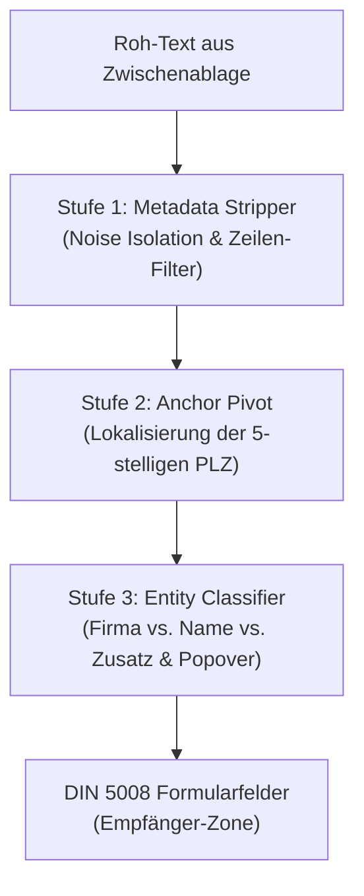

# 09 — Modernisierung der Text- und Address Intelligence (Intl.Segmenter, RegExp /v & 3-Stufen-Pipeline)

> **Status:** Konzept / Architektur-Plan  
> **Kontext:** DIN-BriefNEO verarbeitet im Browser Empfängernamen, Adressen, Titel und Zwischenablage-Inhalte rein clientseitig ohne Node.js-Backend und ohne externe Bibliotheken. Bisherige Parser in [`/home/moritz/repos/DIN-BriefNEO/website/js/salutation.js`](file:///home/moritz/repos/DIN-BriefNEO/website/js/salutation.js) und [`/home/moritz/repos/DIN-BriefNEO/website/js/address.js`](file:///home/moritz/repos/DIN-BriefNEO/website/js/address.js) stützen sich auf String-Splits (`split(/\s+/)`) und reguläre Ausdrücke im ASCII-Modus mit Word-Boundaries (`\b`), was bei Umlauten, Bindestrich-Namen, Titeln mit Punkten (`Dr.`, `e.V.`) und unstrukturierten E-Mail-Signaturen an Grenzen stößt.  
> **Ziel:** Umfassende Modernisierung auf Basis moderner ECMAScript-Standards (ECMA-402 `Intl.Segmenter` und ECMAScript 2024 RegExp `/v` `unicodeSets`) sowie Etablierung einer deterministischen 3-Stufen-Pipeline für die Zwischenablage — voll kompatibel mit dem Projekt-Target **Baseline Chrome 150+** und dem Zero-Dependency-Gebot.

---

## 1. Architektonische Ausgangslage & Ziel-Vorgaben

DIN-BriefNEO verfolgt das Ziel, einen hochpräzisen, DIN-5008-konformen Brief-Editor ohne serverseitige Verarbeitung bereitzustellen. Für die Erkennung und Segmentierung natürlicher Sprache gelten strenge architektonische Rahmenbedingungen:

1. **Zero External Dependencies:** Bibliotheken wie `libphonenumber`, `compromise`, `xregexp` oder NLP-Libraries sind im Projekt verboten. Alle Heuristiken müssen auf standardisierten Browser-APIs aufsetzen.
2. **Target Platform Baseline Chrome 150+:** Das Projekt setzt auf moderne Evergreen-Browser. Alle Spezifikationen, die in ECMAScript 2024 (RegExp `/v`) und ECMA-402 (`Intl.Segmenter`) verabschiedet wurden, stehen ohne Transpiler oder Polyfills nativ zur Verfügung.
3. **Hermetik & Performance (Law A38 & A49):** Parser-Abläufe müssen synchron, blockierungsfrei (< 16 ms) und allocationsarm sein. Unnötige Speicherallokationen (GC Pressure durch zehntausende temporäre Substring-Objekte) sind zu vermeiden.

---

## 2. Hebel 1: `Intl.Segmenter` (W3C ECMA-402 & ICU4C)

### 2.1 Spezifikationsgrundlage & Funktionsweise

Die ECMAScript Internationalization API (`Intl.Segmenter`, ECMA-402) bietet locale-sensitive Textsegmentierung auf Graphem-, Wort- und Satz-Ebene:

```js
const segmenter = new Intl.Segmenter('de', { granularity: 'word' });
const segments = segmenter.segment(text);
```

Unter der Haube delegiert die V8-Engine (Chromium) die Segmentierung direkt an die native C++-Bibliothek **ICU4C** (`icu::BreakIterator`), welche die Regeln des **Unicode Standard Annex #29 (UAX #29: Unicode Text Segmentation)** implementiert.

Jeder Iterationsschritt über `segmenter.segment()` liefert ein Descriptor-Objekt:
```ts
interface SegmentData {
  segment: string;      // Der extrahierte Textabschnitt
  index: number;        // UTF-16-Startindex im Originalstring
  input: string;        // Der ursprüngliche Eingabestring
  isWordLike: boolean;  // true = Wort / Zahl, false = Satzzeichen / Whitespace
}
```

### 2.2 Sprachliches Verhalten im Deutschen

Das Verhalten von `Intl.Segmenter('de', { granularity: 'word' })` weist im Deutschen charakteristische Eigenschaften auf, die für das Namens- und Adress-Parsing essenziell sind:

#### A. Deutsche Komposita ohne Bindestrich
* **Beispiele:** `Musterstraße`, `Stadtwerke`, `Donaudampfschifffahrtsgesellschaft`, `Bundesamt`.
* **Verhalten:** UAX #29 enthält für Deutsch (im Gegensatz zu Thailändisch oder Japanisch) kein integriertes Wörterbuch für die Zerlegung morphologischer Komposita.
* **Ergebnis:** Deutsche Komposita bleiben als **einzelnes** Wortsegment (`isWordLike: true`) erhalten.
* **Nutzen:** Keyword-Checks wie `COMPANY_KEYWORDS.has(token.toLowerCase())` oder Suffix-Prüfungen (`token.endsWith('werke')`, `token.endsWith('kasse')`) funktionieren deterministisch und ohne unbeabsichtigte Wortzerstückelung.

#### B. Bindestrich-Namen & Doppelnamen
* **Beispiele:** `Hans-Peter`, `Müller-Lüdenscheidt`, `Dr.-Ing.`, `Karl-Heinz`.
* **Verhalten nach UAX #29:** Der Standard-Bindestrich (`-`, U+002D) ist in den standardmäßigen UAX-#29-Wortgrenzregeln **kein** `MidLetter` (im Gegensatz zum Apostroph oder hebräischen Punctuation-Markern).
* **Ergebnis:** `Hans-Peter` wird in **drei** Segmente unterteilt:
  1. `segment: "Hans"`, `isWordLike: true`
  2. `segment: "-"`, `isWordLike: false`
  3. `segment: "Peter"`, `isWordLike: true`
* **Architektur-Konsequenz:** Ein naives Filtern über `[...segments].filter(s => s.isWordLike)` trennt `Hans` von `Peter` und zerstört den Doppelnamen! Ein intelligenter Name-Tokenizer muss Segmente zusammenkleben, wenn zwischen zwei `isWordLike: true`-Segmenten genau ein Bindestrich ohne umschließenden Whitespace liegt.

#### C. Abkürzungen mit Punkt
* **Beispiele:** `Dr.`, `Prof.`, `e.V.`, `Str.`, `bzw.`
* **Verhalten:** Der Punkt (`.`, U+002E) ist nach UAX #29 als `MidNumLet` definiert:
  - Zwischen Buchstaben (z. B. `e.V`) bindet der Punkt über Rule WB6/WB7: Das Segment lautet `"e.V"` (`isWordLike: true`).
  - Am Ende eines Wortes mit nachfolgendem Leerzeichen (`Dr. Müller`) greift Rule WB7 nicht: `"Dr"` ist `isWordLike: true`, gefolgt von `"."` (`isWordLike: false`).
* **Nutzen:** Titel wie `Dr.` oder `Prof.` lassen sich anhand des Segmentwerts und des unmittelbar folgenden Punkt-Segments exakt identifizieren, ohne dass der Punkt im Substring hängen bleibt.

#### D. Adelspartikel & Namenszusätze
* **Beispiele:** `von`, `vom`, `zu`, `zur`, `van der`, `de`, `ten`, `di`.
* **Verhalten:** Werden als eigenständige `isWordLike: true`-Wörter mit exakten Offset-Indizes geliefert. In der Nachnamens-Synthese können sie über ein `PARTICLES`-Set rückwärts akkumuliert werden.

### 2.3 Performance-, GC- und Allokations-Vergleich

| Eigenschaft | `text.split(/\s+/)` | `new Intl.Segmenter(...)` (pro Call) | `Intl.Segmenter` (statisch/wiederverwendet) |
| :--- | :--- | :--- | :--- |
| **Instantiierungs-Overhead** | Keine (Regex-Engine) | **Hoch (~1.5–3.0 ms)** — lädt ICU-Collation-Tabellen | **0 ms** (einmalig beim Modulstart) |
| **Speicherallokation** | Eager: Erzeugt volles Array aller Teilstrings | Erzeugt Instanz + Iterator | Lazy: Iterator erzeugt flüchtige Records in V8 NewSpace |
| **GC-Belastung (Scavenge)** | Hoch bei langen Strings | Mittel | **Minimal** (kurzlebig, sub-microsecond) |
| **Satzzeichen-Abtrennung** | Nein (Punkte/Kommata kleben am Wort) | Ja | **Ja** (`isWordLike: false` sauber getrennt) |
| **Abbruch-Möglichkeit** | Nein (vollständiger Scan) | Ja (`for...of` mit `break`) | **Ja** (Early Exit nach Erkennung) |

> [!IMPORTANT] Instantiierungs-Invariante
> `new Intl.Segmenter` darf **niemals** innerhalb einer Parsing-Schleife, eines Event-Handlers (`input`, `blur`) oder einer oft aufgerufenen Hilfsfunktion instanziiert werden. Die Instanz muss als modul- oder klassenweites statisches Singleton vorgehalten werden:
> ```js
> static #wordSegmenter = new Intl.Segmenter('de', { granularity: 'word' });
> ```

### 2.4 Konkreter Blueprint für `salutation.js`

In [`/home/moritz/repos/DIN-BriefNEO/website/js/salutation.js`](file:///home/moritz/repos/DIN-BriefNEO/website/js/salutation.js) ersetzt der nachfolgende Segmenter-Tokenizer das bisherige fehleranfällige `text.split(/\s+/).filter(...)`:

```js
// /home/moritz/repos/DIN-BriefNEO/website/js/salutation.js

/** Statische Segmenter-Instanz für wortbasierte de-Zerlegung */
const WORD_SEGMENTER = new Intl.Segmenter('de', { granularity: 'word' });

/**
 * Tokenisiert einen deutschen Namen unter Beibehaltung von Bindestrich-Namen
 * und filtert akademische Grade und Titel sauber heraus.
 * @param {string} rawName
 * @returns {{ tokens: string[], titles: string[] }}
 */
export function tokenizeGermanName(rawName) {
  if (!rawName?.trim()) return { tokens: [], titles: [] };

  const segments = Array.from(WORD_SEGMENTER.segment(rawName.trim()));
  const assembledWords = [];
  const titles = [];

  const KNOWN_TITLES = new Set(['dr', 'prof', 'dipl', 'ing', 'mag', 'med', 'jur', 'rer', 'nat']);

  for (let i = 0; i < segments.length; i++) {
    const s = segments[i];
    if (!s.isWordLike) continue;

    const lower = s.segment.toLowerCase();

    // 1. Titel-Erkennung (z. B. "Dr." oder "Dr.-Ing.")
    if (KNOWN_TITLES.has(lower)) {
      titles.push(s.segment);
      continue;
    }

    // 2. Bindestrich-Verbund rekonstruieren (z. B. Hans-Peter, Müller-Lüdenscheidt)
    let compoundWord = s.segment;
    while (
      i + 2 < segments.length &&
      segments[i + 1].segment === '-' &&
      segments[i + 2].isWordLike &&
      // Kein Leerzeichen um den Bindestrich:
      segments[i].index + segments[i].segment.length === segments[i + 1].index &&
      segments[i + 1].index + 1 === segments[i + 2].index
    ) {
      compoundWord += `-${segments[i + 2].segment}`;
      i += 2;
    }

    assembledWords.push(compoundWord);
  }

  return { tokens: assembledWords, titles };
}
```

---

## 3. Hebel 2: RegExp `/v` Flag (ECMAScript 2024 / TC39 `unicodeSets`)

### 3.1 Evolution: Von `/u` zu `/v`

Das `/v`-Flag (`unicodeSets`, TC39 Proposal Stage 4, ECMAScript 2024) stellt eine grundlegende Erweiterung der JavaScript-RegExp-Engine dar.

| Feature | Legacy Regex | RegExp `/u` (ES2015) | RegExp `/v` (ES2024) |
| :--- | :--- | :--- | :--- |
| **Surrogate Pairs** | Zerstückelt (2 Code Units) | Korrekte Code Points | Korrekte Code Points |
| **Character Properties** | Nein | `\p{L}`, `\p{N}` etc. | `\p{L}`, `\p{N}`, String-Properties |
| **Set-Operationen (`--`, `&&`)** | Nein | Syntax-Fehler | **Voll unterstützt** (UTS #18) |
| **Multi-Char-Klassen (`\q{...}`)**| Nein | Syntax-Fehler | **Voll unterstützt** |
| **Unicode Case Folding (`/i`)** | Nur 1:1 Mappings | Nur 1:1 Mappings | **Vollständig** (z. B. `ß` zu `ss`) |
| **ASCII-`\b`-Problem** | Vorhanden | **Unverändert vorhanden** | Durch `(?<!\p{L})` / `(?!\p{L})` lösbar |

### 3.2 Die ASCII-`\b`-Falle und ihre Beseitigung

In allen JavaScript-Versionen (auch bei gesetztem `/u`-Flag) ist die Wortgrenze `\b` starr als Übergang zwischen `\w` (`[0-9A-Z_a-z]`) und `\W` definiert. Für die deutsche Sprache führt das zu zwei kapitalen Fehlern:

#### 1. Umlaute und scharfes S
* `\w` umfasst **keine** Umlaute (`ä`, `ö`, `ü`, `Ä`, `Ö`, `Ü`, `ß`).
* Für die RegExp-Engine ist ein deutsches `ä` ein Nicht-Wort-Zeichen (`\W`).
* Folge:
  ```js
  /\bä\b/u.test(" ä "); // => FALSE!
  ```
  Da Leerzeichen (`\W`) und `ä` (`\W`) aufeinandertreffen, existiert hier aus Sicht der Engine **keine** Wortgrenze.

#### 2. Abkürzungen mit Punkt (`Dr.`, `e.V.`, `GmbH & Co. KG`)
* Der Punkt `.` ist ein Nicht-Wort-Zeichen (`\W`).
* Folgt auf den Punkt ein Leerzeichen oder das Zeilenende (ebenfalls `\W`), existiert zwischen Punkt und Leerzeichen **niemals** ein `\b`:
  ```js
  /\bDr\.\b/.test("Dr. Müller"); // => FALSE!
  ```
* Bisherige Notlösungen nutzten uneinheitliche Lookaheads wie `\bDr\.(?!\w)` oder `(?:\s|^)Dr\.(?:\s|$)`.

#### Die universelle Lösung mit `/v`
Unter dem `/v`-Flag werden Wortgrenzen für Unicode-Texte durch explizite Lookarounds mit Unicode-Zeichenklassen formuliert:
* **Echter Unicode-Wortanfang:** `(?<!\p{L})` (Kein Buchstabe unmittelbar davor)
* **Echtes Unicode-Wortende:** `(?!\p{L})` (Kein Buchstabe unmittelbar danach)
* **Alphanumerische Wortgrenze:** `(?<![\p{L}\p{N}])` und `(?![\p{L}\p{N}])`

Beispiel:
```js
const drRegex = /(?<!\p{L})Dr\.(?!\p{L})/v;
drRegex.test("Dr. Müller");   // true
drRegex.test("Herr Dr. med."); // true
drRegex.test("XDr. Y");       // false
```

### 3.3 Set-Differenzen und String-Klassen in Klassen

Mit UTS #18 Set-Notation (`[...--...]`) können Zeichenmengen mathematisch subtrahiert werden:
* Nur Konsonanten: `[\p{Letter}--[aeiouäöüAEIOUÄÖÜ]]/v`
* Alle Buchstaben außer ASCII: `[\p{Letter}--[a-zA-Z]]/v`
* Strings in Klassen: `[\q{GmbH & Co. KG|e. V.|e.V.|AG|SE|KG|GmbH}]/v`

### 3.4 Konkrete Regex-Muster für DIN-BriefNEO

```js
// /home/moritz/repos/DIN-BriefNEO/website/js/address.js (Modernisierte RegExp /v Muster)

/** Deutsche Rechtsformen (ohne \b-Fehler bei Punkten und Umlauten) */
export const CORP_REGEX_V = /(?<!\p{L})(?:gmbh\s*&\s*co\.?\s*kg|gmbh|ag|se|kg|ohg|ug|gbr|universit[äa]t|hochschule|verband|stiftung|beh[öo]rde|institut|verlag|kanzlei|praxis|apotheke|b[üu]ro|agentur|studio|klinik|hotel|restaurant|bank|sparkasse|e\.?\s*v\.?|e\.?\s*k\.?|e\.?\s*g\.?)(?!\p{L})/iv;

/** Anreden und Personen-Präfixe */
export const PERSON_PREFIX_REGEX_V = /^(?:herrn?|frau|dr\.?|prof\.?|z\.?\s*hd\.?|zu\s*h[äa]nden)(?!\p{L})/iv;

/** Straßentypen und Postfächer */
export const STREET_REGEX_V = /(?<!\p{L})(?:str(?:aße|asse|\.)?|weg|platz|allee|damm|ring|ufer|gasse|zeile|chaussee|markt|pfad|steig|grund|graben|berg|anger|feld|kamp|rain|stiege|wall|bruch|garten|park|promenade|tor|h[öo]fe?|speersort|spitze|bellevue|postfach)(?!\p{L})/iv;

/** Nicht-adressrelevante Metadaten-Zeilen */
export const METADATA_LINE_REGEX_V = /^(?:tel(?:efon)?|mobil(?:funk)?|handy|fon|phone|fax|telefax|e-?mail|https?:\/\/|www\.|iban|bic|ust-?id(?:nr)?|steuernummer|st\.-?nr|amtsgericht|handelsregister|hr[ab])(?:\b|[:.\s/])/iv;

/** PLZ und Ortsname mit Unicode-Großbuchstabe als Anfang */
export const PLZ_ORT_REGEX_V = /(?<!\d)(\d{5})\s+([\p{Lu}\p{Lt}][\p{L}\s\-/.]+?)(?=\s*(?:[,;(]|$|\b(?:tel|fax|e-mail)\b))/v;
```

---

## 4. Hebel 3: Deterministische 3-Stufen-Pipeline für Zwischenablage-Adressen

Unstrukturierte Adressblöcke aus E-Mails, Impressum-Websites, PDFs oder Signaturen enthalten häufig Stördaten (Geschäftsführer, Handelsregisternummern, Telefonblöcke, IBANs). Ein robuster Parser muss diese Stördaten deterministisch isolieren, anstatt zu versuchen, sie als Empfängernamen zu erraten.



### 4.1 Stufe 1: Metadata Stripper (Filterung & Normalisierung)

1. **Inline-Normalisierung:** Text wird an Zeilenumbrüchen (`\r?\n`) zerlegt. Enthält der Text keine Umbrüche, aber Kommas oder Semikolons bei gleichzeitigem Vorhandensein einer PLZ, wird er entlang der Trennzeichen in virtuelle Zeilen expandiert.
2. **Noise-Stripping:** Jede Zeile wird gegen `METADATA_LINE_REGEX_V` geprüft:
   - Telefon-, Mobil- und Faxnummern
   - E-Mail-Adressen und URLs (`http`, `https`, `www.`)
   - Bankverbindungen (IBAN, BIC)
   - Handelsregisterangaben (`Amtsgericht Charlottenburg HRB 12345`)
   - Steuerangaben (`USt-IdNr: DE...`, `St.-Nr. ...`)
   - Organigramm-Zeilen (`Geschäftsführer: ...`, `Vorstand: ...`, `Aufsichtsratsvorsitzender: ...`)
3. **Abschnittsüberschriften bereinigen:** Vorangestellte Etiketten wie `"Postanschrift:"`, `"Hausadresse:"`, `"Lieferanschrift:"`, `"Kontakt:"` werden am Zeilenanfang per Regex abgeschnitten.

### 4.2 Stufe 2: Anchor Pivot (Die 5-stellige PLZ als unantastbarer Anker)

Im deutschen Adressraum ist die **5-stellige Postleitzahl** die verlässlichste geometrische Invariante:
1. Der Text wird nach allen Vorkommen von `PLZ_ORT_REGEX_V` durchsucht.
2. Jede gefundene PLZ definiert einen Ankerpunkt bei Zeilenindex $i$:
   - **Zeile $i$:** Postleitzahl und Ort (`10115 Berlin`).
   - **Zeile $i-1$:** Straßenzeile oder Postfach (`Friedrichstraße 42` oder `Postfach 10 20 30`).
3. **Validierung der Straßenzeile ($i-1$):**
   - Enthält ein Straßenschlüsselwort (`STREET_REGEX_V`), ODER
   - Enthält eine Hausnummer (`/(?<!\d)\d+\s*[\p{L}]?(?:[-\/]\d+[\p{L}]?)?(?!\d)/v`), ODER
   - Beginnt mit `"Postfach"`.
   - Ist $i-1$ keine gültige Straßenzeile, wird die Suche bis maximal $i-2$ ausgeweitet (z. B. bei eingeschobenen Ortsteilnamen).

### 4.3 Stufe 3: Entity Classifier (Klassifikation der Empfängerzeilen)

Die verbleibenden 1 bis 3 Zeilen vor der Straßenzeile ($i-2$ bis $i-4$) enthalten die eigentlichen Empfängerdaten. Sie werden klassifiziert in:
- **`firma`:** Name des Unternehmens, der Behörde oder Institution.
- **`name`:** Name der natürlichen Person oder Ansprechpartners.
- **`zusatz`:** Adresszusatz (z. B. Abteilung, c/o, Gebäude/Stockwerk).

#### Deterministische Klassifikations-Matrix:

| Anzahl Vorzeilen | Zeile $i-2$ | Zeile $i-3$ | Zeile $i-4$ | Ableitung |
| :--- | :--- | :--- | :--- | :--- |
| **1 Zeile** | Enthält `CORP_REGEX_V` | — | — | `firma = Line[i-2]`, `name = ""` |
| **1 Zeile** | Kein Corp-Match | — | — | `firma = ""`, `name = Line[i-2]` |
| **2 Zeilen** | Person / `z. Hd.` | Firma (`CORP_REGEX_V`) | — | `firma = Line[i-3]`, `name = Line[i-2]` (Klassischer Firmenbrief an Mitarbeiter) |
| **2 Zeilen** | Firma (`CORP_REGEX_V`) | Person | — | `firma = Line[i-2]`, `name = Line[i-3]` (Privatanschrift an Firma) |
| **2 Zeilen** | Kein Corp-Match | Kein Corp-Match | — | `firma = Line[i-3]`, `name = Line[i-2]` (Fallback: Obere Zeile = Organisation/Zusatz) |
| **3 Zeilen** | Person / `z. Hd.` | Abteilung / Zusatz | Firma (`CORP_REGEX_V`) | `firma = Line[i-4]`, `zusatz = Line[i-3]`, `name = Line[i-2]` |

### 4.4 Behandlung von Mehrdeutigkeiten & Popover-UX

Wenn die Zwischenablage mehrere Anschriften enthält (z. B. Impressum mit Hauptsitz und Niederlassung, oder mehrere Ansprechpartner):
1. **Kein blindes Raten:** Der Parser übernimmt nicht willkürlich die erste Adresse.
2. **Native Popover-Präsentation:** Über das bestehende `<div id="plz-suggestions-popover" popover>` werden dem Nutzer alle extrahierten Kandidaten mit Firmenname, Straße und Ort als interaktive Liste präsentiert.
3. **Tastatur- & Touch-Navigation:** Volle Barrierefreiheit über ARIA (`role="listbox"`, `tabindex="0"`, Pfeiltastennavigation, Enter zur Übernahme).

---

## 5. Konkrete Implementierungs-Blueprints

### 5.1 Refaktorisierter `ClipboardAddressParser`

```js
// /home/moritz/repos/DIN-BriefNEO/website/js/address.js

export class ModernClipboardAddressParser {
  static #wordSegmenter = new Intl.Segmenter('de', { granularity: 'word' });

  /**
   * Extrahiert strukturierte Adressen aus unstrukturiertem Text.
   * @param {string} text
   * @returns {AddressCandidate[]}
   */
  static parse(text) {
    if (!text?.trim()) return [];

    // 1. Textzeilen aufbereiten und bereinigen
    let rawLines = text.split(/\r?\n/).map(l => l.trim()).filter(Boolean);

    // Fallback für einzeilige Adressen (z. B. Google Maps / CSV)
    if (rawLines.length === 1 && rawLines[0].includes(',')) {
      rawLines = rawLines[0].split(',').map(l => l.trim()).filter(Boolean);
    }

    // Stufe 1: Metadata Stripper
    const cleanLines = rawLines
      .filter(l => !METADATA_LINE_REGEX_V.test(l))
      .filter(l => !SECTION_LABEL_REGEX.test(l))
      .map(l => l.replace(/^(?:postanschrift|hausanschrift|anschrift|adresse|kontakt)\s*:\s*/iv, '').trim())
      .filter(Boolean);

    /** @type {AddressCandidate[]} */
    const candidates = [];

    // Stufe 2: Anchor Pivot (PLZ als Anker)
    for (let i = 0; i < cleanLines.length; i++) {
      const line = cleanLines[i];
      const plzMatch = line.match(PLZ_ORT_REGEX_V);
      if (!plzMatch || i === 0) continue;

      const plz = plzMatch[1];
      const ort = plzMatch[2].trim();

      // Straße suchen (Zeile i-1)
      const prevLine = cleanLines[i - 1];
      const isStreet = STREET_REGEX_V.test(prevLine) || /(?<!\d)\d+\s*[\p{L}]?(?!\d)/v.test(prevLine);
      if (!isStreet) continue;

      const strasse = prevLine.replace(/,+$/, '').trim();

      // Stufe 3: Entity Classifier (Vorzeilen analysieren)
      const preLines = [];
      for (let j = i - 2; j >= Math.max(0, i - 4); j--) {
        const pl = cleanLines[j];
        if (PLZ_ORT_REGEX_V.test(pl)) break; // Stopp bei vorangehender Adresse
        preLines.unshift(pl);
      }

      let firma = '';
      let name = '';
      let zusatz = '';

      if (preLines.length === 1) {
        if (CORP_REGEX_V.test(preLines[0])) {
          firma = preLines[0];
        } else {
          name = preLines[0];
        }
      } else if (preLines.length === 2) {
        const [l0, l1] = preLines;
        if (CORP_REGEX_V.test(l0)) {
          firma = l0;
          if (PERSON_PREFIX_REGEX_V.test(l1) || !/\d/.test(l1)) {
            name = l1.replace(/^(?:z\.\s*hd\.|zu\s*händen)\s*:?\s*/iv, '').trim();
          } else {
            zusatz = l1;
          }
        } else if (CORP_REGEX_V.test(l1)) {
          firma = l1;
          name = l0;
        } else {
          firma = l0;
          name = l1;
        }
      } else if (preLines.length >= 3) {
        firma = preLines[0];
        zusatz = preLines[1];
        name = preLines[2].replace(/^(?:z\.\s*hd\.|zu\s*händen)\s*:?\s*/iv, '').trim();
      }

      candidates.push({
        firma,
        name,
        zusatz,
        strasse,
        plz,
        ort,
        source_type: 'pipeline'
      });
    }

    return candidates;
  }
}
```

---

## 6. Testfälle & Verifikations-Matrix

Die nachfolgenden Testfälle decken alle historischen Problemfälle ab und dienen als Kriterien für die Test-Suite:

| ID | Test-Input | Erwartetes Parsing-Ergebnis | Relevanter Hebel |
| :--- | :--- | :--- | :--- |
| **TC-01** | `Dr. Hans-Peter von Müller-Lüdenscheidt` | Vorname: `Hans-Peter`, Nachname: `von Müller-Lüdenscheidt`, Titel: `Dr.` | Hebel 1 (Segmenter Bindestrich & Partikel) |
| **TC-02** | `Musterfirma e.V.` | Als Organisation erkannt, neutrale Anrede (`Sehr geehrte Damen und Herren,`) | Hebel 2 (RegExp `/v` Wortgrenze bei Punkt) |
| **TC-03** | `Überlingen am Bodensee` | Korrekte Großbuchstaben-Erkennung trotz führendem Umlaut `Ü` | Hebel 2 (`\p{Lu}`) |
| **TC-04** | E-Mail-Signatur mit Tel, Fax, Mail, IBAN und Adresse | Adresse extrahiert, alle Metadaten restlos gestrippt | Hebel 3 (Stufe 1 Metadata Stripper) |
| **TC-05** | Google Maps Einzeiler: `Acme Corp, Berliner Str. 10, 10115 Berlin` | `firma`: Acme Corp, `strasse`: Berliner Str. 10, `plz`: 10115, `ort`: Berlin | Hebel 3 (Inline-Expansion) |
| **TC-06** | `Dipl.-Ing. Heinz e.K.` | Rechtsform erkannt, Anrede neutral, keine Fehlinterpretation als Straßenname | Hebel 1 + Hebel 2 |

---

## 7. Referenzen & Upstream-Quellen

1. **ECMA-402 (Intl.Segmenter):**
   - Spezifikation: [ECMA-402 Intl.Segmenter Specification](https://tc39.es/ecma402/#segmenter-objects)
   - Unicode Standard Annex #29 (UAX #29): [Unicode Text Segmentation](https://unicode.org/reports/tr29/)
   - MDN Web Docs: [Intl.Segmenter](https://developer.mozilla.org/en-US/docs/Web/JavaScript/Reference/Global_Objects/Intl/Segmenter)
2. **ECMAScript 2024 (RegExp `/v` Flag / `unicodeSets`):**
   - TC39 Proposal: [RegExp `v` flag with set notation and properties of strings](https://github.com/tc39/proposal-regexp-v-flag)
   - V8 Dev Blog: [RegExp v flag with set notation](https://v8.dev/features/regexp-v-flag)
   - Unicode Technical Standard #18 (UTS #18): [Unicode Regular Expressions](https://unicode.org/reports/tr18/)
   - MDN Web Docs: [RegExp unicodeSets (/v)](https://developer.mozilla.org/en-US/docs/Web/JavaScript/Reference/Global_Objects/RegExp/unicodeSets)
3. **DIN-Normen:**
   - DIN 5008:2020-03 (Schreib- und Gestaltungsregeln für die Text- und Informationsverarbeitung)
